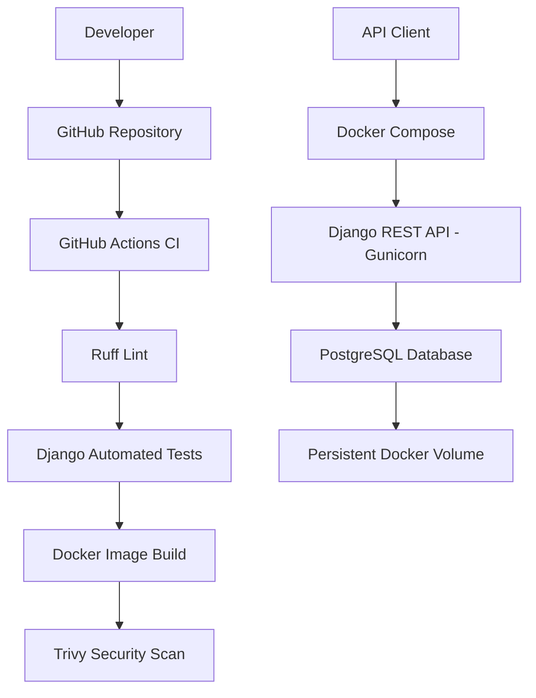

# Apex Operations API – Architecture

## Application Architecture

## Deployment and Rollback Process

1. Developer pushes code to GitHub.
2. GitHub Actions runs linting and automated tests.
3. Docker image is built and scanned.
4. A versioned image is deployed using `deploy.bat`.
5. An earlier version can be restored using `rollback.bat`.

## Components

- Django REST Framework – API application.
- Gunicorn – Application server.
- PostgreSQL – Database.
- Docker Compose – Container orchestration.
- GitHub Actions – Continuous integration.
- Ruff – Code linting.
- Trivy – Container security scanning.